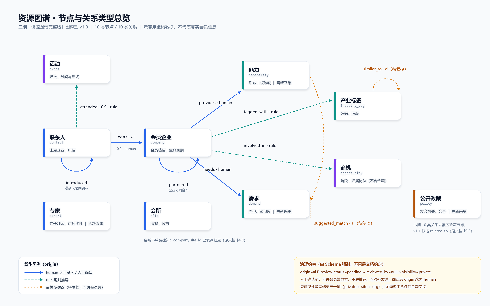

# 资源图谱完整版 · 节点与关系类型定义草案

| 项目 | 内容 |
|---|---|
| 所属工单 | 【S6-PLAN-009】会员空间平台 · 资源图谱完整版：节点与关系类型定义草案 |
| 所属阶段 | Stage vi 陪跑与二期第一批 · 模块：二期规划与新会所复制 |
| 文档版本 | v1.1（对应 Schema `2020-12` v1.1；v1.1 为返修版，变更见文末修订记录） |
| 交付日期 | 2026-11-23 |
| 交付物形态 | 本文档（Markdown + PDF）、两份 JSON Schema、30 节点 + 50 关系样例、校验脚本与实跑证据、关系示意图（SVG + PNG） |
| 数据说明 | 全部样例均为虚构数据，企业名统一带「（虚构）」后缀，联系人为「张示例 / 李样例 / 王虚构」，不含任何真实企业、真实个人信息，不出现客户名称 |

---

## 1. 范围与约定

### 1.1 本单交付的边界

本单只交付**图模型定义**，即「有哪些节点、有哪些关系、每个字段是什么含义、什么数据能变成节点或关系、治理规则如何被机器强制执行」。具体包含：

1. 10 类节点与 10 类关系的定义、属性、取值约束与示例（第 4、5 章）；
2. 每种节点与一期已有表的字段级映射，一期拿不到的明确标注「需新采集」（第 6 章）；
3. 两份 draft 2020-12 JSON Schema，把结构约束与治理规则写成可执行校验（`schema/`）；
4. 30 个节点、50 条关系的虚构样例（`data/`），全部通过 Schema 校验；
5. 一条命令可复跑的校验脚本与实跑输出（第 10 章）；
6. 关系示意图（`diagram/`）。

### 1.2 明确不在本单范围

- 图数据库（Neo4j / AGE / pgRouting 等）的选型、建库、索引与查询实现；
- 一期数据抽取 ETL 代码与调度；
- 复核队列的界面与后台实现（本单只定义队列的**状态与约束**，第 7.1 节）；
- Figma 设计稿；
- 真实业务数据的接入与清洗；
- 会员端 / 小程序端的检索、推荐接口。

### 1.3 全局约定

| 约定 | 内容 |
|---|---|
| 节点 ID | 落库一律 UUID v4（`id`），样例为便于阅读使用 `<node_type>_<三位序号>` 短码（如 `company_001`）。Schema 的 `id` 同时接受两种形态；短码形态还要求前缀等于 `node_type`（`then.properties.id.pattern`），避免「类型与 ID 不自洽」这类脏数据。短码另可写入可选的 `display_code` 列供工单、截图与文档引用 |
| 边 ID | 落库 UUID v4；样例用 `e_<三位序号>` 短码。边可增删（重建时重整），**不进入对外引用**；对外一律只引用节点 ID |
| 多租户 | 节点与边都必带 `org_id`；跨集团的边在写入前即被拒绝（校验脚本会检查两端 `org_id` 是否一致） |
| 统一字段 | 节点与边同层携带 `id`、`org_id`、`site_id`、`created_at`、`created_by`、`updated_at`、`deleted_at`，与业务表建表约定一致；`deleted_at` 非空即软删除，默认不参与图谱遍历 |
| 时间 | `valid_from` / `valid_to` 组成**半开区间** `[valid_from, valid_to)`；两者都必填，`valid_to` 为 `null` 表示当前仍有效 |
| 金额 | **图模型不含任何金额字段**。金额一律按业务主键回查业务接口，AI 不计算金额（见第 7.2 节） |
| 数据 | 一律虚构；不出现客户名称；不使用真实个人信息 |

> 短码与 UUID 的关系：`id` 是唯一主键，生产数据写 UUID；样例用短码是为了让 30 节点 / 50 关系的对照表可读，短码同时写入 `display_code`。两种形态都在 Schema 的 `id` 约束内，因此样例与生产数据共用同一份契约，不存在「样例能过、上线报错」的落差。

### 1.4 文档与 Schema 的版本对应

文档版本与两份 Schema 的版本一一对应，改动任一方都必须同步。本次交付：文档 `v1.1` 与 `node.schema.json` / `edge.schema.json` 的 `$id` 均含 `v1`（见第 9 章）。

---

## 2. 模型总览

### 2.1 二部结构

图谱只有两类实体：**节点**（10 类，回答「有什么」）与**边**（10 类，回答「怎么连」）。边不承载业务对象，只承载关系与治理属性（权重、证据、来源、时间、可见性）。

| 分区 | 节点类型 | 说明 |
|---|---|---|
| 主体 | `company`、`contact`、`expert`、`site` | 会员企业、企业内部可对接人、可对接专家、会所场地 |
| 供需 | `capability`、`demand`、`industry_tag` | 企业能提供什么、会员需要什么、产业分类 |
| 业务 | `event`、`opportunity` | 活动场次、商机 |
| 外部 | `policy` | 公开政策摘要（本期无对应边类型，见第 9 章扩展示例） |

### 2.2 关系方向约定

边的方向读作「**source 对 target 施加 edge_type**」。例如 `contact_001 --works_at--> company_001` 读作「张示例任职于示例科技」。方向不是装饰：`introduced` 的 source 是引荐人、target 是被引荐人；`partnered` 的 source 是发起方、target 是承接方。同一对节点之间允许存在反向的两条边（如 `e_026` 与 `e_029`），它们表达不同视角，不做去重。

### 2.3 关系示意图



图中实线为 `human`（人工录入或人工确认）、点划线为 `rule`（规则推导）、虚线为 `ai`（模型建议、待复核，不进会员端）。**10 类节点全部出现，10 类关系全部出现**；卡片上标注「需新采集」的 `capability`、`demand`、`expert`、`policy` 四类节点一期无来源（见第 6 章）。

---

## 3. 公共字段

### 3.1 节点公共字段

| 字段 | 类型 | 必填 | 说明 |
|---|---|---|---|
| `id` | string（UUID 或短码） | 是 | 主键，落库 UUID v4；短码形态前缀 = node_type，见第 1.3 节 |
| `display_code` | string | — | 可读短码（`company_001`），由文档 / 工单引用，不承担主键职责 |
| `node_type` | enum(10) | 是 | 闭合枚举；新增类型须升版本 |
| `org_id` | string | 是 | 集团 ID |
| `site_id` | string \| null | 是 | 会所 ID；为 `null` 表示集团级节点，此时 `visibility` 必须为 `org`（Schema 强制） |
| `created_at` | date-time | 是 | 统一字段：创建时间 |
| `created_by` | string | 是 | 统一字段：创建者（user_id / agent_id / 系统作业名） |
| `updated_at` | date-time | 是 | 统一字段：最后更新时间 |
| `deleted_at` | date-time \| null | 是 | 统一字段：软删除时间；非空即软删除，默认不参与遍历与检索 |
| `name` | string | 是 | 展示名；样例统一带「（虚构）」 |
| `visibility` | enum(org/site/private) | 是 | 可见范围 |
| `source_state` | enum(phase1/new_collection) | 是 | 一期可得 / 需新采集，见 3.3 |
| `source_ref` | object | 条件 | `source_state=phase1` 必填，`new_collection` 禁止出现 |
| `collection_hint` | string | 条件 | `new_collection` 必填：建议采集方式 |
| `summary` | string | — | 一句话摘要，用于检索与展示 |

### 3.2 边属性总表

| 字段 | 类型 | 必填 | 取值 / 说明 |
|---|---|---|---|
| `id` | string（UUID 或短码） | 是 | 主键，落库 UUID v4；样例为 `e_001` 短码 |
| `display_code` | string | — | 可读短码，样例中与 `id` 同值 |
| `org_id` | string | 是 | 必须与两端节点一致 |
| `site_id` | string \| null | 是 | 统一字段：两端同属一个会所时取该会所；跨会所或集团级关系为 `null`（表示「不属于单一会所」，不是「无归属」），可见性仍按两端更严一侧继承 |
| `created_at` / `created_by` / `updated_at` / `deleted_at` | 同节点 | 是 | 统一字段，语义与 3.1 一致；`deleted_at` 非空即软删除的边，默认不参与遍历 |
| `source_id` | string | 是 | 起点节点 ID |
| `target_id` | string | 是 | 终点节点 ID |
| `edge_type` | enum(10) | 是 | 闭合枚举 |
| `weight` | number | 是 | 闭区间 `[0,1]`；`0` 表示成立但权重为零，不参与排序，**不等于删除** |
| `evidence_ref` | object | 是 | `{source_table, source_id, source_field?}`；`ai` 边指向模型运行记录 |
| `confidence` | number | 是 | 闭区间 `[0,1]` |
| `origin` | enum | 是 | `human` / `rule` / `ai` |
| `valid_from` | date-time | 是 | 区间左端点（含） |
| `valid_to` | date-time \| null | 是（可为 `null`） | 区间右端点（不含）；`null` 为长期有效。**必填**，缺字段即校验失败（见 10.4 第五个坏样例） |
| `visibility` | enum | 是 | `org` / `site` / `private`；取两端更严一侧，`ai` 边在 `pending` / `rejected` 时强制 `private` |
| `evidence_state` | enum | — | `live`（默认）/ `soft_deleted`；后者把 `confidence` 上限压到 0.5 |
| `review_status` | enum | 条件 | `origin=ai` 必填：`pending`（待复核）/ `approved`（人工确认）/ `rejected`（人工驳回），三值均可达 |
| `reviewed_by` | string \| null | 条件 | `pending` 时必须为 `null`；`approved` / `rejected` 时必须为具体复核人 |
| `reviewed_at` | date-time \| null | 条件 | `pending` 时为 `null`；`approved` / `rejected` 时为实际复核时间 |
| `note` | string | — | 冲突裁决等人工备注 |

> 工单原文列出的 10 个属性（source_id、target_id、edge_type、weight、evidence_ref、confidence、origin、valid_from、valid_to、visibility）全部保留且**全部必填**（`valid_to` 允许 `null`）。`id`、`org_id` 与统一字段 `site_id` / `created_at` / `created_by` / `updated_at` / `deleted_at` 与业务表建表约定一致，同为必填；它们不替代任何原文属性。`display_code` 是可选的可读列。

### 3.3 来源状态：让「需新采集」可被机器判定

`source_state` 不是注释，而是 Schema 的强制字段：`phase1` 必须给出 `source_ref`（表名 + 记录 ID + 用到的字段），`new_collection` 必须给出 `collection_hint` 且禁止出现 `source_ref`。因此**验收方不需要逐条读文档**——跑一次校验脚本就会打印来源分布（本次输出：`phase1 18 / new_collection 12`）。

---

## 4. 节点类型定义

以下 10 节结构统一：定义 → 关键属性 → 一期来源（或「需新采集」）→ 样例。完整样例见 `data/nodes.json`。

### 4.1 `company` 会员企业

**定义** 图谱主体。一家会员企业在图中只有一个 `company` 节点，与它相关的联系人、能力、需求、商机、标签都通过边挂接。

**关键属性**

| 属性 | 必填 | 取值 | 说明 |
|---|---|---|---|
| `industry_tag_ids` | 是 | 节点 ID 数组，≥1 | 产业标签索引，由 `tagged_with` 边派生；边为权威，数组须与边一致（校验脚本比对） |
| `member_level` | 是 | founding / standard / premium / strategic | 会员档位 |
| `lifecycle_stage` | 是 | prospect / active / renewing / churned | 生命周期 |

**一期来源** `crm_company`：`name`、`short_name`、`member_level`（由会籍档位派生）、`lifecycle_stage`（由会籍状态派生）、`site_id`。产业标签来自 `crm_company_tag.tag_id`：**权威关系落成 `tagged_with` 边**，节点上的 `industry_tag_ids` 只是由边派生的检索索引（便于按产业直查），二者必须一致，`verify.py` 会逐企业比对。

**样例** `company_001` 示例科技（虚构）· premium · active · `industry_tag_001`/`industry_tag_003`

### 4.2 `contact` 联系人

**定义** 会员企业内可对接的自然人。图谱只保留「是谁、在哪家公司、什么职位」，**不落明文手机号与邮箱**——那属于 CRM 的加密字段与权限域，跨模块复制会扩大泄露面。

**关键属性** `primary_company_id`（主属企业，必填）、`job_title`（必填）。

**一期来源** `crm_contact`：`name`、`job_title`、`company_id`、`site_id`。手机号/邮箱仅保留掩码形态，不进入图谱字段。

**样例** `contact_001` 张示例 · 示例科技（虚构）· 技术总监

### 4.3 `industry_tag` 产业标签

**定义** 产业分类的受控词表节点，来自字典中心，支撑 `tagged_with` 与语义相似两类关系。

**关键属性** `tag_code`（`^TAG-[A-Z]{2,6}-[0-9]{2}$`）、`tag_level`（1–3）。

**一期来源** `tax_tag`：`code`、`name`、`level`。母子关系可用 `tax_tag_relation` 表达；本期用 `tag_level` 层级近似，v1.2 可增 `parent_of` 边（见第 9 章）。

**样例** `industry_tag_002` 新能源 · `TAG-NEE-01` · level 1

### 4.4 `capability` 能力

**定义** 企业可对外提供的产品 / 服务 / 整体方案，是「资源对接」供给侧的核心对象。撮合（`suggested_match`）只在能力与需求之间发生。

**关键属性** `capability_type`（product / service / solution，必填）、`maturity`（concept / pilot / ga，必填）。

**一期来源** **需新采集**。一期没有「能力」对象：`crm_company` 只有行业与规模，`crm_interaction` 只有非结构化纪要，`tax_tag` 只表达产业分类，都无法还原「这家企业能交付什么」。硬用行业标签代替能力，会让撮合退化成「同行业即推荐」，误报率不可控。

**采集建议** 会员档案「能力清单」表单，字段：能力名称、形态、成熟度、可交付范围、对外联系人、是否愿意对外露出。

**样例** `capability_002` 储能系统集成方案 · solution · pilot

### 4.5 `demand` 需求

**定义** 会员企业的采购、合作、人才、空间等诉求。

**关键属性** `demand_type`（procurement / cooperation / talent / space / other）、`urgency`（high / medium / low）、`industry_tag_ids`。

**一期来源** **需新采集**。一期的 `crm_lead`（招商线索）语义是「外部企业想入驻」，与「已入驻会员的诉求」不是一回事，直接复用会造成对象混淆。

**采集建议** 需求登记表单：需求类型、描述、期望时间、决策人、可投入资源（预算区间仅作登记口径，**不进入图模型**）。

**样例** `demand_001` 采购 MES 轻量版 · procurement · high

### 4.6 `event` 活动

**定义** 会所举办的产业活动场次（含线上）。它是「弱关系」的主要证据来源：参加同一场活动是引荐与撮合的常见触发点。

**关键属性** `starts_at`、`ends_at`（date-time，`ends_at` 必须晚于 `starts_at`）、`event_format`（offline / online / hybrid）。

**一期来源** `event`：`title`、`starts_at`、`ends_at`、`format`、`site_id`。参与关系来自 `event_registration` 与 `event_checkin`。

**样例** `event_001` 秋季产业对接会 · 2026-09-18 13:30–17:30 · offline

### 4.7 `opportunity` 商机

**定义** 招商、合作、会籍升级等可推进的业务机会。

**关键属性** `stage`（qualifying / proposal / negotiation / won / lost）、`owner_role`（investment_advisor / member_manager / opportunity_manager）。

**一期来源** `crm_opportunity`：`title`、`stage`、`owner_role`、`company_id`、`site_id`。**estimated_amount_first_year 等金额字段刻意不入图**（原因见 7.2）。

**样例** `opportunity_001` 示例智造扩租洽谈 · negotiation · investment_advisor

### 4.8 `expert` 专家

**定义** 可为会员提供专业支持的顾问（内部专家或外部合作专家）。

**关键属性** `expertise_areas`（1–5 项）、`availability`（open / limited / closed）、`visibility`（可为 `private`）。

**一期来源** **需新采集**。一期无专家库；且专家多为外部自然人，采集必须配合「是否愿意对外露出」的授权开关，否则会造成个人信息越权展示。

**采集建议** 专家档案表单：专长领域、可服务形式、可承接时段、是否对外露出（直接决定 `visibility`）。

**样例** `expert_002` 赵样例 · 储能 / 电力电子 / 并网合规 · `private`（仅本人与授权人可见）

### 4.9 `site` 会所

**定义** 集团下属会所场地节点。

**关键属性** `site_code`（`^SITE-[A-Z]{1,3}[0-9]{2}$`）、`city`。

**一期来源** `iam_site`：`code`、`name`、`city`、`site_id`。

**说明** 会所与企业的归属**不建边**：`company.site_id` 已经表达，重复建边会产生两套真相。会所作为独立节点的用途是承载「跨会所复制」阶段的对比分析（见示意图备注）。

**样例** `site_001` 示例会所·A 座 · SITE-A01 · 上海

### 4.10 `policy` 公开政策

**定义** 与会员产业相关的公开政策摘要（非全文）。

**关键属性** `issuing_authority`、`policy_no`（`^POL-[0-9]{4}-[0-9]{3}$`）、`effective_from`（date）。

**一期来源** **需新采集**。一期无政策库；政策文本需人工摘要后入库，不能由模型直接改写原文。

**采集建议** 政策库导入模板列：发文机关、文号、生效日期、适用产业、申报截止、原文链接、摘要。

**样例** `policy_001` 产业扶持资金申报指南 · POL-2026-001 · 2026-03-01

---

## 5. 关系类型定义

### 5.1 总表

| # | edge_type | 读法 | 端点约束（Schema 强制） | 典型证据 | 样例条数 |
|---|---|---|---|---|---|
| 1 | `works_at` | A 任职于 B | contact → company | `crm_contact.company_id` | 5 |
| 2 | `provides` | A 提供 B（能力） | company → capability | 能力清单 / 纪要 | 5 |
| 3 | `needs` | A 需要 B（需求） | company → demand | 需求登记 / 纪要 | 5 |
| 4 | `attended` | A 参加了 B（活动） | contact\|company → event | 报名表 / 签到 | 5 |
| 5 | `introduced` | A 引荐了 B | contact → contact | 纪要（含「介绍/引荐」） | 5 |
| 6 | `partnered` | A 与 B 合作 | company → company | 合同 / 纪要 | 5 |
| 7 | `tagged_with` | A 属于产业 B | company → industry_tag | `crm_company_tag` | 5 |
| 8 | `involved_in` | A 关联商机 B | company → opportunity | `crm_opportunity.company_id` | 5 |
| 9 | `suggested_match` | 能力 A 可满足需求 B | capability → demand | `ai_match_run`（模型运行记录） | 5 |
| 10 | `similar_to` | A 与 B 语义相近 | 同类型节点之间 | `ai_embed_run`（向量运行记录） | 5 |

「端点约束」不是文档约定，而是写进 Schema 的 `if/then`（`source_id` / `target_id` 的 `pattern`）。若有人把 `works_at` 写成 `company → contact`，校验会直接失败并指出是哪条边。

**每种关系的代表样例**（每类另有 4 条，完整 50 条见 `data/edges.json`）：`works_at` `e_001`、`provides` `e_010`、`needs` `e_015`、`attended` `e_016`、`introduced` `e_024`、`partnered` `e_026`、`tagged_with` `e_033`、`involved_in` `e_036`、`suggested_match` `e_045`、`similar_to` `e_046`。选例兼顾三种 `origin`：人工（`e_001`）、规则（`e_010`）、模型建议（`e_045`）。

### 5.2 各类关系的判定规则

1. **works_at**：以「当前主属企业」为 `primary_company_id`，历史任职单独成边并用 `valid_to` 截断。同一联系人可以有多条 `works_at`（样例 `e_001` / `e_002` 即两段任职，区间不重叠）。
2. **provides**：只连「企业 → 能力节点」，不连「企业 → 企业」。能力必须是结构化对象；仅凭纪要关键词命中的边 `origin=rule`、`weight≤0.4`，且需复核（样例 `e_010`）。
3. **needs**：同上，需求必须是登记过的对象。活动报名备注推出的需求（样例 `e_015`）标 `rule`。
4. **attended**：企业级参加（company → event）与个人级参加（contact → event）都允许，但**不得由企业级参加自动生成个人级参加**——那会把「公司来了三个人」误记成「全公司都来了」。
5. **introduced**：必须能指向一条具体纪要；引荐人、被引荐人、时间三者齐备。反向引荐是另一条边，不合并。
6. **partnered**：以合同或双方确认的纪要为准；单方表述不足以建边。
7. **tagged_with**：由标签中心同步，`origin=rule`、`weight=1.0`（分类确定性强）；人工调整的标签 `origin=human`（样例 `e_033`）。
8. **involved_in**：一个商机可以关联多家企业（如联合方案），`e_036`/`e_037` 为同一企业参与两个商机。
9. **suggested_match**：**只能由模型产生**，方向固定「能力 → 需求」，`origin=ai`、`visibility=private`、`review_status=pending`。人工确认后改 `origin=human` 才能进入会员端推荐。
10. **similar_to**：只连同类型节点（标签与标签、专家与专家、能力与能力、需求与需求；Schema 用 `anyOf` 强制两端前缀一致），`origin=ai`，用于「你可能也感兴趣」的候选池，同样需复核。

### 5.3 一条完整的边样例

```json
{
  "id": "e_024",
  "display_code": "e_024",
  "org_id": "org_demo01",
  "site_id": null,
  "source_id": "contact_001",
  "target_id": "contact_003",
  "edge_type": "introduced",
  "weight": 0.5,
  "evidence_ref": {
    "source_table": "crm_interaction",
    "source_id": "it_4012",
    "source_field": "summary"
  },
  "confidence": 0.4,
  "origin": "human",
  "valid_from": "2026-08-30T00:00:00+08:00",
  "valid_to": null,
  "visibility": "site",
  "evidence_state": "soft_deleted",
  "created_at": "2026-08-30T00:00:00+08:00",
  "created_by": "seed_demo",
  "updated_at": "2026-09-02T10:15:00+08:00",
  "deleted_at": null,
  "note": "证据纪要已被软删除：边保留、confidence 降至 0.4 并列入复查清单。"
}
```

这条边同时演示了三个约束：可见性按端点（`contact_003` 为 site）继承、证据软删除后 `confidence ≤ 0.5`（Schema 强制）、边不因证据消失而删除。

---

## 6. 一期来源映射

### 6.1 节点级映射总表

| 节点类型 | 一期表 | 用到的字段 | 状态 |
|---|---|---|---|
| `company` | `crm_company` | name, short_name, member_level, lifecycle_stage, site_id | 一期可得 |
| `contact` | `crm_contact` | name, job_title, company_id, site_id | 一期可得 |
| `industry_tag` | `tax_tag` | code, name, level | 一期可得 |
| `capability` | — | — | **需新采集** |
| `demand` | — | — | **需新采集** |
| `event` | `event` | title, starts_at, ends_at, format, site_id（线上场次无 site_id） | 一期可得 |
| `opportunity` | `crm_opportunity` | title, stage, owner_role, company_id, site_id | 一期可得 |
| `expert` | — | — | **需新采集** |
| `site` | `iam_site` | code, name, city, site_id | 一期可得 |
| `policy` | — | — | **需新采集** |

**18 个节点来自一期表，12 个节点需新采集**（与校验脚本输出的 `source coverage: phase1 18 / new_collection 12` 一致）。

### 6.2 边级证据表

| edge_type | 主要证据表 | 说明 |
|---|---|---|
| `works_at` | `crm_contact`、`event_registration` | 报名表填写的公司名只能产生 `rule` 边，需人工确认 |
| `provides` / `needs` | 能力清单、需求登记、`crm_interaction` | 需要新采集对象，纪要只能提供弱证据 |
| `attended` | `event_registration`、`event_checkin` | 签到记录最可靠，`origin=rule` 即可信 |
| `introduced` / `partnered` | `crm_interaction`、`crm_contract` | 必须有具体记录，且指向 `source_id` |
| `tagged_with` | `crm_company_tag`、`tax_tag_relation` | 由标签中心同步，`weight=1.0` |
| `involved_in` | `crm_opportunity`、`crm_interaction` | 商机主关联用 `company_id`，弱关联用纪要 |
| `suggested_match` | `ai_match_run` | 模型运行记录：输入指纹、模型版本、得分 |
| `similar_to` | `ai_embed_run` | 向量运行记录：模型版本、相似度 |

### 6.3 为什么这四类一期拿不到

| 对象 | 一期的最近似物 | 为什么不能替代 |
|---|---|---|
| `capability` | `crm_company` 的行业字段、`crm_interaction` 纪要 | 行业≠能力；纪要是非结构化文本，抽取出的「能力」无法保证完整性与可复核性 |
| `demand` | `crm_lead`（招商线索） | 线索是「想入驻的外部企业」，需求是「已入驻会员的诉求」，对象与生命周期都不同 |
| `expert` | 无 | 一期没有专家对象，且涉及外部自然人信息，必须配套授权采集 |
| `policy` | 无 | 政策需人工摘要入库，模型不得改写政策原文 |

---

## 7. 治理规则

### 7.1 `origin=ai` 的复核闸门

模型可以提议关系，但不能直接对外呈现。这条规则**写进了 Schema**：

```json
{
  "if": { "properties": { "origin": { "const": "ai" } }, "required": ["origin"] },
  "then": {
    "required": ["review_status", "reviewed_by"],
    "allOf": [
      {
        "if": { "properties": { "review_status": { "const": "pending" } }, "required": ["review_status"] },
        "then": { "properties": { "reviewed_by": { "const": null }, "reviewed_at": { "type": "null" },
                                  "visibility": { "const": "private" } } }
      },
      {
        "if": { "properties": { "review_status": { "enum": ["approved", "rejected"] } }, "required": ["review_status"] },
        "then": { "properties": { "reviewed_by": { "type": "string", "minLength": 1 },
                                  "reviewed_at": { "type": "string", "format": "date-time" } } }
      },
      {
        "if": { "properties": { "review_status": { "const": "rejected" } }, "required": ["review_status"] },
        "then": { "properties": { "visibility": { "const": "private" } } }
      }
    ]
  }
}
```

`origin=ai` 的边必须带 `review_status`，并按状态分三种形态校验：`pending` 要求 `reviewed_by=null`、`reviewed_at=null`、`visibility=private`；`approved` / `rejected` 要求 `reviewed_by` 与 `reviewed_at` 都落到具体值；`rejected` 额外强制保持 `private`。任一形态不满足即校验失败——这是「AI 关系未复核就展示给会员」这类事故的最后一道闸。

**origin 不因人工确认而改写**：人工确认的是「这条建议可以采信」，不是「这条关系由人创造」。把 `origin` 从 `ai` 改成 `human` 会抹掉「由模型提议」这一来源事实，后续既无法统计模型命中率，也无法回溯提示词与模型版本。因此正确做法是：`origin` 保持 `ai`，写 `review_status=approved` + `reviewed_by`，`visibility` 再按两端重新继承。

**状态机**

| 状态 | 谁可以进入 | 约束 | 去向 |
|---|---|---|---|
| `pending` | 模型产出时自动进入 | `visibility=private`、`reviewed_by=null`、`reviewed_at=null`，不进会员端检索 / 推荐 / 外发 | 复核通过 → `approved`；复核驳回 → `rejected` |
| `approved` | 仅人工复核可置 | `origin` 仍为 `ai`；`reviewed_by` / `reviewed_at` 必填；`visibility` 按两端重新继承 | 进入正常检索与推荐 |
| `rejected` | 仅人工复核可置 | `origin` 仍为 `ai`；`reviewed_by` / `reviewed_at` 必填；`visibility` 强制 `private` | 边留档、不展示；证据记录不删除，便于复盘模型为何误判 |

> `rejected` 是可达状态而不是摆设：它在样例集之外由复核动作产生，Schema 允许它存在并把它钉在 `private`。这样「驳回」不再等于「删行」，而是留下一条可审计的负样本记录。

**人工确认前不得对外**：`visibility=private` 在读取侧等价于「仅创建者与授权人可见」，会员端检索接口在实现时必须叠加 `review_status='approved'` 过滤。两者是双保险：Schema 管写，接口管读。

### 7.2 金额禁区

- 图模型中**没有任何金额字段**：两份 Schema 都是 `additionalProperties: false`，任何 `amount` / `price` / `budget` 字段都会被校验拒绝（见 10.4 的第四个坏样例：多带一个 `amount` 字段即被判不合法）。
- 商机金额通过 `opportunity.id` 调业务接口获取，`crm_opportunity.estimated_amount_first_year` 只存在于业务库。
- **AI 不计算任何金额**：模型只输出关系与权重，不参与报价、不按金额排序、不生成金额文案。金额只以「分」为单位的整数出现在业务接口层。

### 7.3 可见性继承对照表

边的 `visibility` 取两端节点更严的一侧，严格顺序 `private > site > org`：

| 端点 A | 端点 B | 边的 visibility |
|---|---|---|
| org | org | org |
| org | site | site |
| org | private | private |
| site | site | site |
| site | private | private |
| private | private | private |

**这是可被检查的**：校验脚本会逐条比较边与两端节点，发现「边比端点更宽」就报错。本次生成样例时确实抓到 5 条越界（`e_014`、`e_019`、`e_022`、`e_024`、`e_040`），修正后才通过——说明这条规则不是纸面约定。

### 7.4 证据软删除的降级

证据记录（如一条纪要）被软删除（`deleted_at` 非空）时：

1. 边**不自动删除**（关系事实曾经存在，历史查询仍需要）；
2. 标记 `evidence_state=soft_deleted`；
3. `confidence` 上限强制压到 `0.5`（Schema 的 `if/then` 已固化），并由 `rule` 降级处理——样例 `e_024` 即为 0.4；
4. 进入复查清单，由运营决定「重新取证」还是「置 `valid_to` 收尾」。

### 7.5 去标识与虚构数据

- 样例中企业名统一为「示例科技（虚构）」这类命名，联系人为「张示例 / 李样例 / 王虚构」，不含真实手机号、邮箱、身份证、地址；
- 交付物中不出现客户名称；
- 图谱不复制 CRM 的敏感字段（手机号、邮箱明文），只保留节点引用；
- 本单信息仅用于完成本单。

---

## 8. 边界情况

| # | 边界 | 判定规则 | 对应样例 |
|---|---|---|---|
| 1 | 时间 | 半开区间 `[valid_from, valid_to)`；`valid_to=null` 为仍有效。同一对节点同类关系可多条；区间重叠时以 `valid_from` 较晚者作为「当前态」，另一条保留但不参与当前态查询 | `e_001` / `e_002`（同一联系人两段任职） |
| 2 | 取值 | `weight`、`confidence` 闭区间 `[0,1]`；`weight=0` 表示成立但零权重（保留证据、不排序），不是删除；`1.0` 与 `1` 视为同值（JSON 数值相等，Schema 不做区分）。本期样例权重最低 0.25，未为凑数构造 0 值边 | `e_045`（0.4，低权重建议） |
| 3 | 可见性冲突 | 边取两端更严一侧，见 7.3 对照表；Schema 校验字段形态，继承结果由校验脚本检查 | `e_024`（端点 site → 边 site） |
| 4 | 证据失效 | 软删除 → 边保留、`evidence_state=soft_deleted`、`confidence≤0.5`、进复查清单 | `e_024` |
| 5 | AI 初始态 | `origin=ai` 强制 `pending` + `reviewed_by=null` + `private`，三者缺一即校验失败 | 10 条 ai 边全部如此 |
| 6 | 类型扩展 | `node_type` / `edge_type` 闭合枚举，新增须同步升版本；改动清单见第 9 章 | — |
| 7 | 样例覆盖 | 10 类各 3 节点（含 1 个 `private` 专家）、10 类各 5 边；`origin` 分布 human 28 / rule 12 / ai 10，10 条 ai 边全为待复核态 | `data/nodes.json`、`data/edges.json` |

---

## 9. 版本管理与扩展

### 9.1 版本号规则

`MAJOR.MINOR`：新增类型 / 新增可选字段 → `MINOR`；删字段、改字段语义、收紧必填 → `MAJOR`。文档与两份 Schema 同版本号；`$id` 中的路径同步（`/v1/node.schema.json`）。

### 9.2 新增一类关系的完整改动清单

以「v1.2 新增 `related_to`（政策 → 企业/需求）」为例，共 6 处，缺一处都会留下不一致：

| # | 改动位置 | 具体动作 | 不改的后果 |
|---|---|---|---|
| 1 | `schema/edge.schema.json` → `edge_type.enum` | 追加 `"related_to"` | 新边无法通过校验 |
| 2 | 同文件 `allOf` | 追加 `if/then`：`source_id` 匹配 `^policy_`，`target_id` 匹配 `^(company\|demand)_` | 端点写反也不会被发现 |
| 3 | 本文档第 5 章 | 总表加一行 + 新增一节（定义、端点、证据、默认 origin） | 文档与机器约束脱节 |
| 4 | `diagram/resource-graph.svg` + PNG | 加一条 `policy → company` 的线并更新图例 | 示意图与定义不符 |
| 5 | `data/edges.json` | 补 5 条样例（覆盖新类型），更新 `origin` 分布说明 | 覆盖矩阵不完整，AC1 抽查会失败 |
| 6 | 版本号 | 文档与两份 Schema 改 `v1.2`，文档加修订记录 | 验收方无法判断拿到的是哪一版 |

**兼容性承诺**：枚举只增不改、`additionalProperties: false` 不变、不给既有类型新增必填字段——因此**老样例在新版本下仍然通过**。校验脚本可直接作为 CI 门禁（`python verify.py` 非 0 即阻断合并）。

### 9.3 本期已知缺口

- `policy` 节点在本期 10 类关系中没有边类型（政策与企业的「适用」关系语义上属于 `related_to`，不在工单给定的 10 类之内）。这是有意留白，不擅自扩枚举；已在示意图上标注，待后续版本处理。
- `industry_tag` 的母子层级暂由 `tag_level` 近似，未建 `parent_of` 边。

---

## 10. 校验与证据

### 10.1 环境

| 项 | 本次实跑 |
|---|---|
| Python | 3.13.14 |
| jsonschema | 4.26.0（`requirements.txt` 已锁定） |
| 操作系统 | Windows 10（10.0.19045） |

### 10.2 复现步骤

```bash
pip install -r requirements.txt
python verify.py --nodes data/nodes.json --edges data/edges.json --schema-dir ./schema
python verify.py --self-test
```

### 10.3 实跑输出（逐字复制，未删改）

```text
python 3.13.14 / jsonschema 4.26.0
loaded schema: node.schema.json (2020-12), edge.schema.json (2020-12)
validating nodes.json ... 30/30 valid
validating edges.json ... 50/50 valid
coverage: node_type 10/10, edge_type 10/10, origin {human:28, rule:12, ai:10}
node_type detail: company:3, contact:3, industry_tag:3, capability:3, demand:3, event:3, opportunity:3, expert:3, site:3, policy:3
edge_type detail: works_at:5, provides:5, needs:5, attended:5, introduced:5, partnered:5, tagged_with:5, involved_in:5, suggested_match:5, similar_to:5
source coverage: phase1 18 / new_collection 12
ai review queue: 10 pending, member-visible ai edges: 0
referential integrity: 50/50 edges resolved
RESULT: PASS
```

### 10.4 校验器自测（证明确实在校验，而不是空跑）

```text
python 3.13.14 / jsonschema 4.26.0
  rejected bad_1_missing_edge_type.json: $: 'edge_type' is a required property
  rejected bad_2_weight_out_of_range.json: $.weight: 1.5 is greater than the maximum of 1
  rejected bad_3_ai_edge_visible_to_member.json: $.visibility: 'private' was expected
  rejected bad_4_amount_field.json: $: Additional properties are not allowed ('amount' was unexpected)
  rejected bad_5_missing_valid_to.json: $: 'valid_to' is a required property
  rejected bad_6_ai_approved_without_reviewer.json: $.reviewed_by: None is not of type 'string'
6/6 correctly rejected
RESULT: PASS
```

六个坏样例分别对应：缺 `edge_type`、`weight` 越界、`origin=ai` 但 `visibility=org`（想绕过复核直接展示）、混入 `amount` 金额字段、缺 `valid_to`、以及 `review_status=approved` 却不写 `reviewed_by`（假装复核过）。第三与第六个最关键——它们证明「AI 关系不得对外」「复核必须留痕」这两条治理规则由机器执行，不依赖人的自觉；第四个证明「金额不进图模型」是结构上的不可能；第五个则把「`valid_to` 必填（可为 null）」从文档承诺变成校验事实。

### 10.5 失败信息怎么读

校验失败会输出到具体字段路径，例如：

```text
  FAIL edge e_903
    - $.visibility: 'private' was expected
```

`$` 是文档根，`.visibility` 是字段名，后面是期望值。定位到边 ID 后，按第 5 章的端点约束或第 7 章的治理规则修正即可，不需要重跑全量。

> 补充：`verify.py` 除了 Schema 校验，还做**引用完整性**检查（端点是否存在、`org_id` 是否一致、边可见性是否宽于端点）与**节点级不变量**检查（`similar_to` 两端必须同类型、活动 `ends_at` 必须晚于 `starts_at`、`primary_company_id` / `industry_tag_ids` 引用必须存在、`company.industry_tag_ids` 必须与 `tagged_with` 边一致、`visibility=site` 必须有 `site_id`）。Schema 管形态，脚本管跨对象与跨字段的一致性，二者缺一都会漏。

---

## 11. 验收对照表

| 验收标准（工单原文） | 对应交付物 | 可验证方式 |
|---|---|---|
| 1. 节点类型不少于 10 种、关系类型不少于 10 种，每种都有定义、属性与示例 | 第 4 章（10 节）、第 5 章（总表 + 10 类判定规则 + 完整边样例）、`schema` 中的 enum、`data` 中的 30+50 条样例 | 数第 4/5 章节数；跑 `verify.py` 看 `node_type 10/10, edge_type 10/10` |
| 2. 每种节点都写明一期来源表与字段，或标注「需新采集」 | 第 4 章每节「一期来源」+ 第 6 章映射总表 + `source_state`/`source_ref`/`collection_hint` 字段 | 跑 `verify.py` 看 `source coverage: phase1 18 / new_collection 12`；Schema 强制 `phase1` 必须有 `source_ref` |
| 3. 30 个节点与 50 条关系的样例全部通过附带的 JSON Schema 校验 | `data/nodes.json`、`data/edges.json`、`schema/*.json`、`verify.py` | 按 10.2 复跑，输出 `30/30 valid`、`50/50 valid`、`RESULT: PASS` |
| 4. 文档写明 `origin=ai` 的关系须经复核队列人工确认，确认前不对会员展示 | 第 7.1 节（状态机 + Schema 片段）、7.2（金额禁区）、Schema 的 `if/then`、10 条 ai 样例 | 跑 `verify.py` 看 `ai review queue: 10 pending, member-visible ai edges: 0`；跑 `--self-test` 看坏样例 3、6 被拒绝（治理规则生效），4、5 被拒绝（金额禁区与 `valid_to` 必填） |

---

## 12. 交付物清单

| 路径 | 内容 | 形态 |
|---|---|---|
| `README.md` | 交付说明与复现指引（先读这个） | Markdown |
| `docs/graph-model.md` | 本文档 | Markdown |
| `docs/graph-model.pdf` | 本文档的 PDF 版 | PDF |
| `schema/node.schema.json` | 节点 Schema（draft 2020-12） | JSON |
| `schema/edge.schema.json` | 关系 Schema（draft 2020-12） | JSON |
| `data/nodes.json` | 30 个虚构节点（10 类 × 3） | JSON |
| `data/edges.json` | 50 条虚构关系（10 类 × 5） | JSON |
| `verify.py` | 校验脚本（Schema + 引用完整性 + 自测） | Python |
| `requirements.txt` | 依赖锁定 | Text |
| `evidence/verify-output.txt` | 校验实跑原始输出 | Text |
| `evidence/self-test-output.txt` | 自测实跑原始输出 | Text |
| `evidence/env.txt` | 运行环境版本记录 | Text |
| `diagram/resource-graph.svg` | 关系示意图源文件 | SVG |
| `diagram/resource-graph.png` | 关系示意图（2 倍分辨率 3200×2000） | PNG |

---

### 修订记录

| 版本 | 日期 | 变更 |
|---|---|---|
| v1.0 | 2026-11-23 | 首版：10 节点 / 10 关系、两份 Schema、30+50 样例、校验脚本、示意图 |
| v1.1 | 2026-11-24 | 返修：`valid_to` 列入必填（可为 null）；节点与边补齐统一字段（`site_id`、`created_at`、`created_by`、`updated_at`、`deleted_at`）并允许 `id` 为 UUID（短码移入 `display_code`）；`origin=ai` 人工确认后保持 `origin` 不变、改 `review_status=approved` 并写 `reviewed_by`，`rejected` 变为可达状态；自测坏样例 4 → 6；示意图字形修复 |
